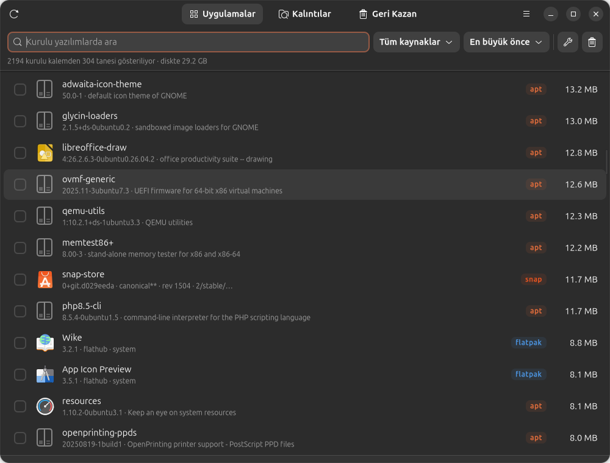
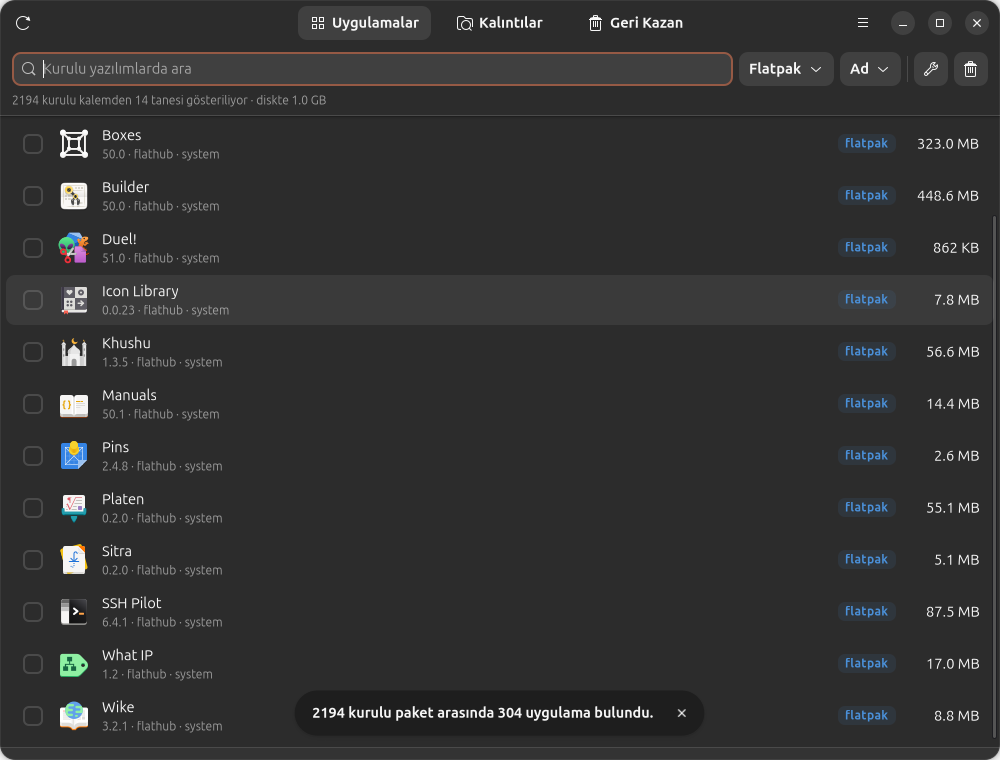

<div align="center">


# AppSweep

**One uninstaller for every way Linux installs software.**

[Türkçe](README.tr.md) · English

</div>

AppSweep lists everything installed on this machine — no matter which
package manager put it there — with how much space it takes, removes any of
it in one step, and then finds the settings, caches and data that
uninstalling leaves behind.

It is the Linux equivalent of the Windows *Apps & Features* list, or of
dragging an `.app` to the Trash on macOS — except that it also accounts for
the leftovers no package manager ever cleans up.



## The problem it solves

When you remove a program with `apt remove`, this is what stays:

| What is left | Where | Does the package manager clean it? |
|---|---|---|
| Configuration | `~/.config/<app>` | Never |
| Application data | `~/.local/share/<app>` | Never |
| Caches | `~/.cache/<app>` | Never |
| Flatpak data | `~/.var/app/<app-id>` | Only with `--delete-data` |
| System config | `/etc/<app>` | Only with `purge` |
| Orphaned dependencies | everywhere | Only if you remember `autoremove` |
| pip / npm / cargo packages | `~/.local`, `/usr/local`, `~/.cargo` | No — the system does not know they exist |

AppSweep puts all of it behind a single confirmation screen.

## Where it looks

| Source | Lists | Removes | Notes |
|---|---|---|---|
| apt / dpkg | ✔ | ✔ | refuses essential and required packages |
| dnf / rpm | ✔ | ✔ | refuses base-system packages |
| pacman | ✔ | ✔ | refuses base-system packages |
| Flatpak | ✔ | ✔ | system and user installations, unused runtimes |
| Snap | ✔ | ✔ | refuses `snapd` and the `core` snaps |
| AppImage | ✔ | ✔ | the file and its launcher go to the trash |
| pip | ✔ | ✔ | **never touches distribution-managed packages** |
| pipx | ✔ | ✔ | removes the whole virtual environment |
| npm | ✔ | ✔ | global prefix only, never a project's `node_modules` |
| cargo | ✔ | ✔ | from `cargo install --list` |

## The three views

**Applications** — everything installed, in one list, with its own icon.
Sort by size or name, filter by source, search, and optionally show the
libraries and runtimes too. Select several and remove them together.

**Leftovers** — directories under your home folder, `/etc` and `/var/lib`
that no installed application accounts for: the residue of software removed
months ago, including software removed before AppSweep existed.

**Reclaim** — space you can get back: download caches, orphaned
dependencies, superseded snap revisions. Each with its measured size.



## Safety model

This program deletes files, so most of the work went into the places where
it does not:

- **Nothing runs unconfirmed.** Every operation becomes a plan first; the
  exact commands are shown on the confirmation screen before anything runs.
- **Protected paths are refused unconditionally.** `/`, `/etc`, `/usr`,
  `~`, `~/.config` and the like, plus `~/.ssh`, `~/.gnupg` and your XDG
  document folders — the names of which are read from
  `~/.config/user-dirs.dirs`, so they are protected under whatever name
  your language gives them. A path is refused whether or not it exists:
  "already gone" can never bypass the guard.
- **Name matching is a guess and is presented as one.** Every leftover is
  labelled `Certain`, `Likely` or `Guess`, and `Guess` entries are never
  pre-selected.
- **A still-installed application wins its directory.** Removing
  `chrome-gnome-shell` will not take `~/.config/google-chrome`.
- **Symlinks, mount points and directories the package database still owns
  are skipped.**
- **Deletions go to the trash** (`gio trash`); permanent deletion is a
  separate opt-in.
- **Critical packages cannot be removed:** `systemd`, `libc6`, kernels,
  the `core`/`snapd` snaps, `pip`/`setuptools`/`wheel`, `npm`/`corepack`,
  and any Python package installed by your distribution.
- **Administrator access is asked for once.** Privileged steps are gathered
  into a single shell script and run once through `pkexec`.

## Install

Ready-made packages are on the
[releases page](https://github.com/M-SukruSezer/AppSweep/releases).

### Debian, Ubuntu and derivatives

```bash
sudo apt install ./appsweep_0.1.0_all.deb
```

Using `apt` rather than `dpkg -i` pulls the dependencies in at the same
time. AppSweep then appears in your application menu, and `appsweep` is on
your `PATH`.

### Fedora, RHEL, openSUSE

```bash
sudo dnf install ./appsweep-0.1.0-1.noarch.rpm
```

On openSUSE use `sudo zypper install ./appsweep-0.1.0-1.noarch.rpm`.

### From source, for one user only

```bash
tar -xzf appsweep-0.1.0.tar.gz
cd appsweep-0.1.0
./install.sh
```

This installs into `~/.local`, needs no root, and places the icon and the
desktop entry. First install the runtime dependencies, which are system
packages rather than PyPI ones:

| Distribution | Command |
|---|---|
| Debian, Ubuntu | `sudo apt install python3-gi gir1.2-gtk-4.0 gir1.2-adw-1` |
| Fedora | `sudo dnf install python3-gobject gtk4 libadwaita` |
| Arch | `sudo pacman -S python-gobject gtk4 libadwaita` |

To run straight from a checkout without installing anything,
`./bin/appsweep` is enough.

### Building the packages yourself

```bash
./packaging/build.sh          # everything this machine can build
./packaging/build.sh deb      # or just one of them
```

The results land in `dist/`. The `.deb` and the `.rpm` are both laid out
by `packaging/install-tree.sh`, so the two always install the same files
in the same places. Building the `.rpm` needs `rpmbuild`; building the
`.deb` needs `dpkg-deb`, and `fakeroot` if you want root-owned files
without being root.

### Removing it

```bash
sudo apt remove appsweep        # or: sudo dnf remove appsweep
```

The source install can be undone by deleting `~/.local/bin/appsweep`,
`~/.local/share/appsweep` and the desktop entry. Your own settings live in
`~/.config/appsweep/settings.json`.

## Command line

Everything the interface does is scriptable:

```bash
appsweep doctor                 # what it can see on this system
appsweep list --by-size         # everything installed, largest first
appsweep list --all             # include libraries and runtimes
appsweep remove vlc -n          # show what it would do, touch nothing
appsweep remove vlc             # remove, then ask about the leftovers
appsweep remove vlc --keep-data # do not scan for leftovers
appsweep leftovers              # find residue from software already gone
appsweep leftovers --remove     # and clear it
appsweep clean --all            # caches and orphaned dependencies
```

`-n` / `--dry-run` works everywhere and changes nothing.

## Language

A three-step rule:

1. If you have chosen a language, that one is used.
2. Otherwise, Turkish if the desktop itself is Turkish.
3. Otherwise English — whatever else the desktop is set to.

Step 3 is deliberately not plain gettext behaviour: left alone, gettext
would pick up the Turkish catalogue from a priority list like
`LANGUAGE=en_GB:tr`.

Change it under **Preferences → Interface language**. The choice is stored
in `~/.config/appsweep/settings.json` and overrides the system. The window
is rebuilt when the language changes, because widgets read their text when
they are built.

To force a language for testing:

```bash
APPSWEEP_LANG=en appsweep
```

Adding a language needs a new `po/*.po` file and one entry in
`i18n.LANGUAGES`.

## Tests

```bash
python3 -m unittest discover -s tests -v
```

69 tests, no extra dependencies. The weight is on the places where a bug
deletes data: refusal of protected paths (including ones that do not
exist), symlinks, XDG document folders in any language, `--dry-run`
touching nothing, and leftover attribution never claiming a directory that
belongs to something still installed. The `cargo` and `pipx` parsers are
tested against captured real output so they can be checked on a machine
where those tools are not installed.

## Architecture

```
appsweep/
├── models.py          App, Residue, Step, Plan — the shared types
├── safety.py          protected paths; every deletion passes through here
├── leftovers.py       finding and scoring residue
├── executor.py        Plan → action; batched privilege escalation
├── icons.py           desktop-entry index and icon matching
├── i18n.py            gettext setup and the language rule
├── settings.py        ~/.config/appsweep/settings.json
├── util.py            running commands, measuring sizes
├── cli.py             command line
├── backends/          one per packaging format
│   ├── base.py        the Backend interface
│   ├── dpkg.py  rpmdnf.py  pacman.py        system
│   ├── flatpak.py  snapd.py  appimage.py    portable
│   └── pip.py  pipx.py  npm.py  cargo.py    language managers
└── ui/                GTK4 + libadwaita
    ├── app.py  window.py  style.py  appicon.py  preferences.py
    ├── page_apps.py  page_leftovers.py  page_cleanup.py
    └── removal.py     review → progress → result

packaging/
├── install-tree.sh    where every installed file goes; shared by both
├── appsweep.spec      RPM recipe
└── build.sh           builds .tar.gz, .deb and .rpm into dist/
```

Adding a packaging format means subclassing `Backend` and adding it to
`ALL` in `backends/__init__.py`. Writing `list_apps()` and
`removal_plan()` is enough; leftover scanning, the safety checks and the
interface are shared.

The application list is virtualised on a `Gtk.ListView`, so more than two
thousand packages scroll smoothly. Every package-manager query and every
directory measurement runs on a background thread.

## Icon

In `data/icons/hicolor/`: a full-colour 128×128 version and a 16×16
symbolic one, following the Adwaita template — GNOME palette, flat
surfaces, an offset darker layer for thickness.

It says one thing, which is the reason this program exists: **the
application has been lifted away, and the shape it occupied is still
there.** The dashed outline is that footprint; the specks inside it are
what is left lying in it.

Two measured notes, in case they are useful to anyone drawing one of
these:

- `org.gnome.baobab`, `Loupe` and `Settings` each cover about **63%** of
  their canvas with ink; this icon covers **47%**. The difference is the
  hollow outline, and filling it would cost the icon its meaning. The
  bounding box (92%) matches theirs.
- **A symbolic icon cannot be drawn with strokes.** GTK renders symbolic
  icons as a mask, which fills strokes in — a stroked outline came out as
  two solid squares. The outline is a filled path with an `evenodd` hole
  instead.

## Known limits

- Directories with very short names (`~/.config/rg`) cannot be attributed:
  fewer than three characters is not enough to tell which program a folder
  belongs to, so AppSweep skips them rather than guessing.
- pip sizes come from each package's `RECORD` file, so `__pycache__`
  files generated afterwards are not counted.
- `gem` and `go install` are not covered yet.
- Translations exist for Turkish and English only.

## Licence

GPL-3.0-or-later. See [LICENSE](LICENSE).
