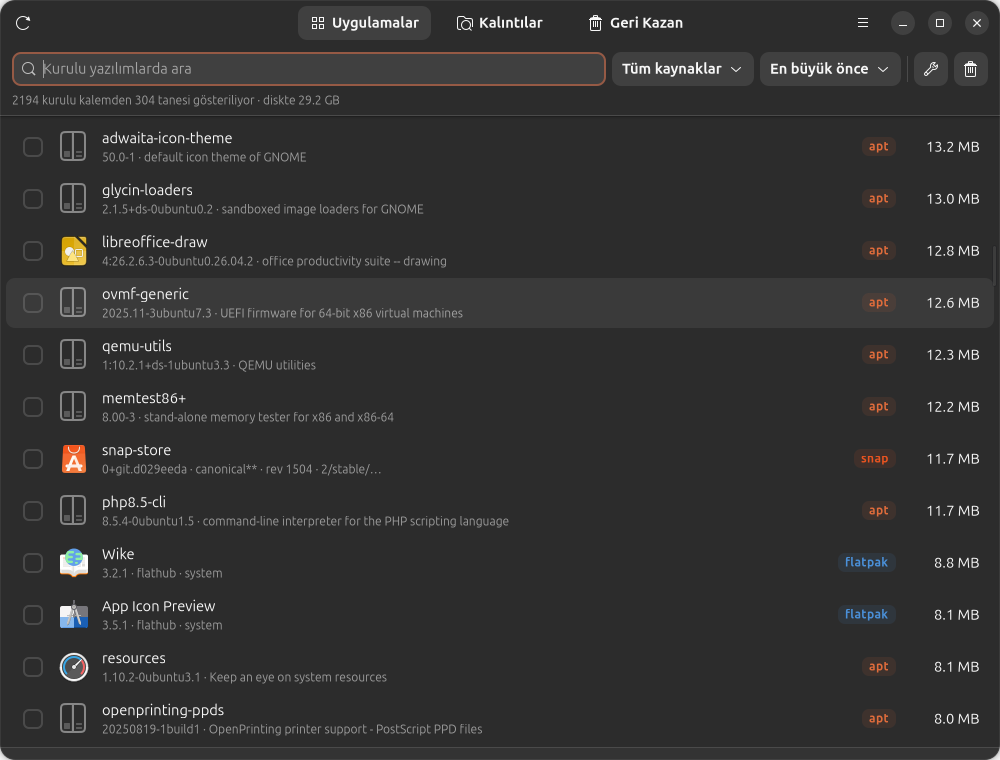
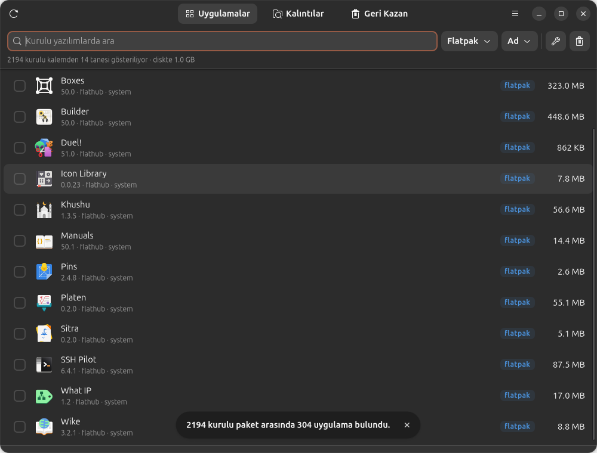

<div align="center">


# AppSweep

**Linux'ta yazılım kurmanın her yolu için tek bir kaldırma aracı.**

Türkçe · [English](README.md)

</div>

AppSweep, bu makinede kurulu olan her şeyi — hangi paket yöneticisi
koymuş olursa olsun — kapladığı alanla birlikte listeler, seçtiklerinizi
tek adımda kaldırır ve ardından kaldırma işleminin geride bıraktığı ayar,
önbellek ve veri klasörlerini bulur.

Windows'un *Yüklü Uygulamalar* listesinin, ya da macOS'te bir `.app`'i çöp
kutusuna atmanın Linux'taki karşılığı — ama hiçbir paket yöneticisinin
temizlemediği kalıntıları da hesaba katarak.



## Çözdüğü sorun

Bir programı `apt remove` ile kaldırdığınızda geride kalanlar:

| Geride kalan | Nerede | Paket yöneticisi temizler mi |
|---|---|---|
| Ayar dosyaları | `~/.config/<uygulama>` | Hayır, asla |
| Uygulama verisi | `~/.local/share/<uygulama>` | Hayır, asla |
| Önbellek | `~/.cache/<uygulama>` | Hayır, asla |
| Flatpak verisi | `~/.var/app/<app-id>` | Yalnızca `--delete-data` ile |
| Sistem ayarları | `/etc/<uygulama>` | Yalnızca `purge` ile |
| Artık bağımlılıklar | her yerde | Yalnızca `autoremove`'u siz yazarsanız |
| pip / npm / cargo paketleri | `~/.local`, `/usr/local`, `~/.cargo` | Hayır — sistem bunların varlığını bilmez |

AppSweep bunların hepsini tek bir onay ekranında toplar.

## Nerelere bakar

| Kaynak | Listeler | Kaldırır | Notlar |
|---|---|---|---|
| apt / dpkg | ✔ | ✔ | temel ve zorunlu paketleri reddeder |
| dnf / rpm | ✔ | ✔ | temel sistem paketlerini reddeder |
| pacman | ✔ | ✔ | temel sistem paketlerini reddeder |
| Flatpak | ✔ | ✔ | sistem ve kullanıcı kurulumları, artık çalışma zamanları |
| Snap | ✔ | ✔ | `snapd` ve `core` snap'lerini reddeder |
| AppImage | ✔ | ✔ | dosya ve başlatıcısı çöp kutusuna gider |
| pip | ✔ | ✔ | **dağıtımın kurduğu paketlere asla dokunmaz** |
| pipx | ✔ | ✔ | sanal ortamın tamamını kaldırır |
| npm | ✔ | ✔ | yalnızca küresel dizin, projenin `node_modules`'ü asla |
| cargo | ✔ | ✔ | `cargo install --list` üzerinden |

## Üç ekran

**Uygulamalar** — kurulu her şey, tek listede, kendi logosuyla. Boyuta ya
da ada göre sıralama, kaynağa göre süzme, arama, istenirse kütüphane ve
çalışma zamanlarını da gösterme. Birden fazlasını seçip birlikte
kaldırabilirsiniz.

**Kalıntılar** — ev klasörünüzün, `/etc` ve `/var/lib` altındaki, hiçbir
kurulu uygulamanın sahiplenmediği dizinler: aylar önce kaldırdığınız,
hatta AppSweep'ten önce kaldırdığınız yazılımların artıkları.

**Geri Kazan** — geri alabileceğiniz alan: indirme önbellekleri, artık
bağımlılıklar, eskimiş snap sürümleri. Her biri ölçülmüş boyutuyla.



## Güvenlik modeli

Bu program dosya siler, dolayısıyla asıl emek silmediği yerlere harcandı:

- **Hiçbir şey onaysız çalışmaz.** Her işlem önce bir plana dönüşür;
  çalışacak komutların tam metni onay ekranında görünür.
- **Korunan yollar koşulsuz reddedilir.** `/`, `/etc`, `/usr`, `~`,
  `~/.config` gibi dizinlerin kendisi, ayrıca `~/.ssh`, `~/.gnupg` ve XDG
  belge klasörleriniz — bunların adları `~/.config/user-dirs.dirs`
  dosyasından okunduğu için dilinizin verdiği adla korunur. Bir yol var
  olmasa bile reddedilir; "zaten silinmiş" cevabı korumayı atlatamaz.
- **İsim eşleşmesi bir tahmindir ve öyle sunulur.** Her kalıntı `Kesin`,
  `Olası` ya da `Tahmin` etiketiyle gelir; `Tahmin` olanlar hiçbir zaman
  önceden seçili gelmez.
- **Hâlâ kurulu bir uygulama kendi dizinini kazanır.**
  `chrome-gnome-shell` kaldırılırken `~/.config/google-chrome` silinmez.
- **Sembolik bağlar, bağlama noktaları ve paket veritabanının hâlâ sahip
  olduğu dizinler atlanır.**
- **Silinenler çöp kutusuna gider** (`gio trash`); kalıcı silme ayrı bir
  seçenektir.
- **Kritik paketler kaldırılamaz:** `systemd`, `libc6`, çekirdek
  paketleri, `core`/`snapd` snap'leri, `pip`/`setuptools`/`wheel`,
  `npm`/`corepack` ve dağıtımın kurduğu Python paketleri.
- **Yönetici yetkisi bir kez sorulur.** Yetki gerektiren adımlar tek bir
  kabuk betiğine toplanır ve `pkexec` ile bir seferde çalıştırılır.

## Kurulum

Sistem bağımlılıkları (PyPI paketi gerekmez):

```bash
sudo apt install python3-gi gir1.2-gtk-4.0 gir1.2-adw-1
```

Fedora'da `python3-gobject gtk4 libadwaita`, Arch'ta
`python-gobject gtk4 libadwaita`.

Sonra:

```bash
./install.sh
```

`~/.local` altına kurar, kök yetkisi istemez, simgeyi ve masaüstü
girdisini de yerleştirir; böylece AppSweep uygulama menünüzde görünür.
Doğrudan depodan çalıştırmak için `./bin/appsweep` yeterli.

## Komut satırı

Arayüzün yaptığı her şey betiklenebilir:

```bash
appsweep doctor                 # bu sistemde neleri gördüğü
appsweep list --by-size         # kurulu her şey, büyükten küçüğe
appsweep list --all             # kütüphaneler ve çalışma zamanları dahil
appsweep remove vlc -n          # ne yapacağını göster, hiçbir şeye dokunma
appsweep remove vlc             # kaldır, sonra kalıntıları sor
appsweep remove vlc --keep-data # kalıntıları tarama
appsweep leftovers              # kaldırılmış yazılımların artıklarını bul
appsweep leftovers --remove     # ve temizle
appsweep clean --all            # önbellekler ve artık bağımlılıklar
```

`-n` / `--dry-run` her yerde çalışır ve hiçbir şeyi değiştirmez.

## Dil

Üç aşamalı bir kural:

1. Bir dil seçtiyseniz o kullanılır.
2. Seçmediyseniz ve masaüstü Türkçeyse Türkçe.
3. Başka her durumda İngilizce — masaüstü hangi dilde olursa olsun.

Üçüncü madde düz gettext davranışından bilerek ayrılır: kendi haline
bırakılsa `LANGUAGE=en_GB:tr` gibi bir öncelik listesinde Türkçe katalogu
yakalardı.

Değiştirmek için **Tercihler → Arayüz dili**. Seçim
`~/.config/appsweep/settings.json` dosyasına yazılır ve sistemin önüne
geçer. Dil değişince pencere yeniden kurulur, çünkü metinler pencereler
kurulurken okunur.

Test için zorlamak:

```bash
APPSWEEP_LANG=en appsweep
```

Yeni dil eklemek için bir `po/*.po` dosyası ve `i18n.LANGUAGES` listesine
bir satır yeterli.

## Testler

```bash
python3 -m unittest discover -s tests -v
```

69 test, ek bağımlılık yok. Ağırlık, hatanın veri sildiği yerlerde:
korunan yolların reddi (var olmayanlar dahil), sembolik bağlar, XDG belge
klasörlerinin her dilde korunması, `--dry-run`'ın hiçbir şeye dokunmaması
ve kalıntı ilişkilendirmesinin hâlâ kurulu bir uygulamaya ait dizini
almaması. `cargo` ve `pipx` çözümleyicileri, bu araçlar kurulu olmayan
makinelerde de denetlenebilsin diye gerçek çıktı örnekleriyle test edilir.

## Mimari

```
appsweep/
├── models.py          App, Residue, Step, Plan — ortak veri tipleri
├── safety.py          korunan yollar; silinecek her yol buradan geçer
├── leftovers.py       kalıntı bulma ve puanlama
├── executor.py        Plan → eylem; pkexec toplu yetkilendirme
├── icons.py           .desktop dizini ve logo eşleştirme
├── i18n.py            gettext kurulumu ve dil kuralı
├── settings.py        ~/.config/appsweep/settings.json
├── util.py            komut çalıştırma, boyut hesabı
├── cli.py             komut satırı
├── backends/          paket biçimi başına bir tane
│   ├── base.py        Backend arayüzü
│   ├── dpkg.py  rpmdnf.py  pacman.py        sistem
│   ├── flatpak.py  snapd.py  appimage.py    taşınabilir
│   └── pip.py  pipx.py  npm.py  cargo.py    dil yöneticileri
└── ui/                GTK4 + libadwaita
    ├── app.py  window.py  style.py  appicon.py  preferences.py
    ├── page_apps.py  page_leftovers.py  page_cleanup.py
    └── removal.py     inceleme → ilerleme → sonuç
```

Yeni bir paket biçimi eklemek, `Backend` sınıfından türetip
`backends/__init__.py` içindeki `ALL` listesine eklemek demek.
`list_apps()` ve `removal_plan()` yazmanız yeterli; kalıntı tarama,
güvenlik kontrolleri ve arayüz ortak.

Uygulama listesi `Gtk.ListView` üzerinde sanallaştırılmıştır, bu yüzden
iki binden fazla paket akıcı kayar. Tüm paket yöneticisi sorguları ve
dizin boyutu hesapları arka plan iş parçacığında çalışır.

## Simge

`data/icons/hicolor/` altında: tam renkli 128×128 sürüm ve 16×16 simgesel
sürüm. Adwaita şablonunu izler — GNOME paleti, düz yüzeyler, kalınlık için
aşağı kaydırılmış koyu katman.

Tek bir şey anlatır, o da bu programın var oluş sebebidir: **uygulama
kaldırılmış, kapladığı yer hâlâ orada.** Kesik çizgili çerçeve o iz;
içindeki zerreler de o izde duran kalıntılar.

Böyle bir simge çizecek olana yarayabilecek iki ölçüm:

- `org.gnome.baobab`, `Loupe` ve `Settings` tuvalinin yaklaşık **%63**'ünü
  mürekkeple kaplıyor; bu simge **%47**. Aradaki fark içi boş çerçeve ve
  onu doldurmak simgenin anlamını götürürdü. Kapladığı dikdörtgen (%92)
  onlarla aynı.
- **Simgesel sürüm konturla çizilemez.** GTK simgesel ikonları maske
  olarak işler ve konturları doldurur; `stroke` ile çizilen çerçeve iki
  dolu kare gibi görünüyordu. Çerçeve bunun yerine `evenodd` ile delik
  bırakılmış dolu bir yol.

## Bilinen sınırlar

- Çok kısa adlı dizinler (`~/.config/rg`) ilişkilendirilemez: üç
  karakterden kısa bir ad hangi programa ait olduğunu söylemeye yetmez,
  bu yüzden AppSweep tahmin etmek yerine atlar.
- pip boyutları paketin `RECORD` dosyasından hesaplanır; sonradan üretilen
  `__pycache__` dosyaları bu toplamın dışında kalır.
- `gem` ve `go install` henüz kapsam dışı.
- Türkçe ve İngilizce dışında çeviri yok.

## Lisans

GPL-3.0-or-later. Bkz. [LICENSE](LICENSE).
